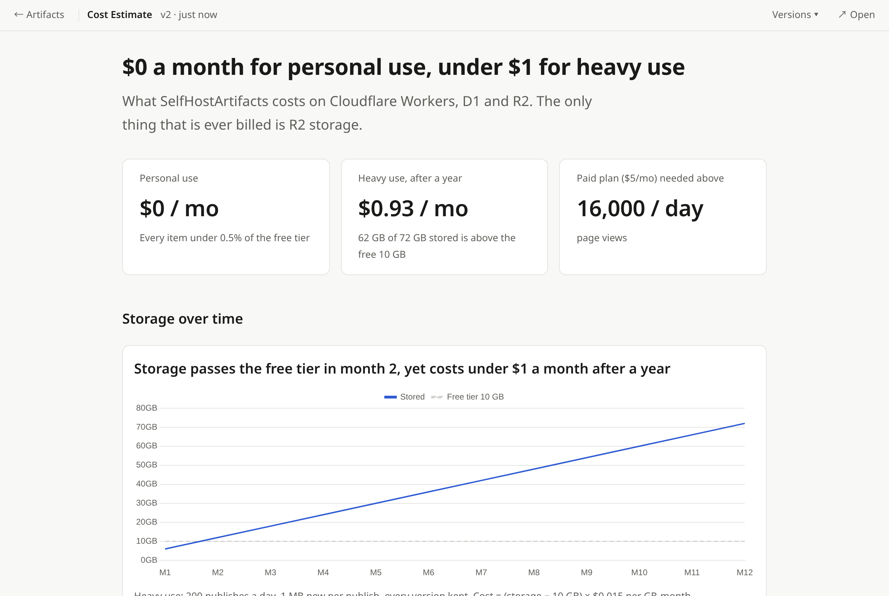
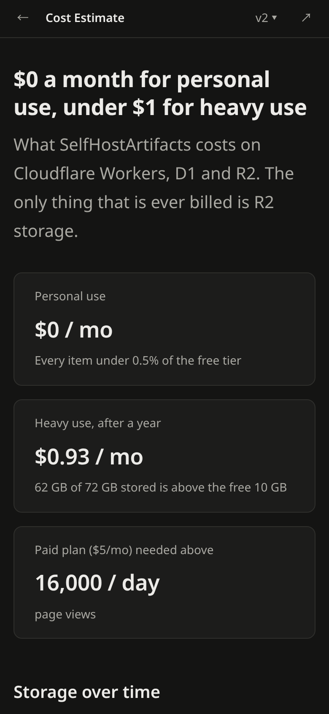
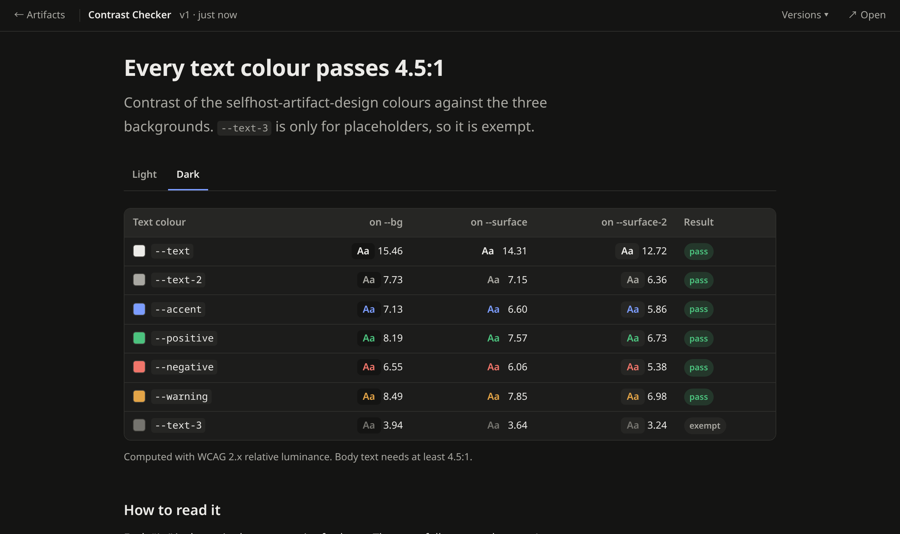
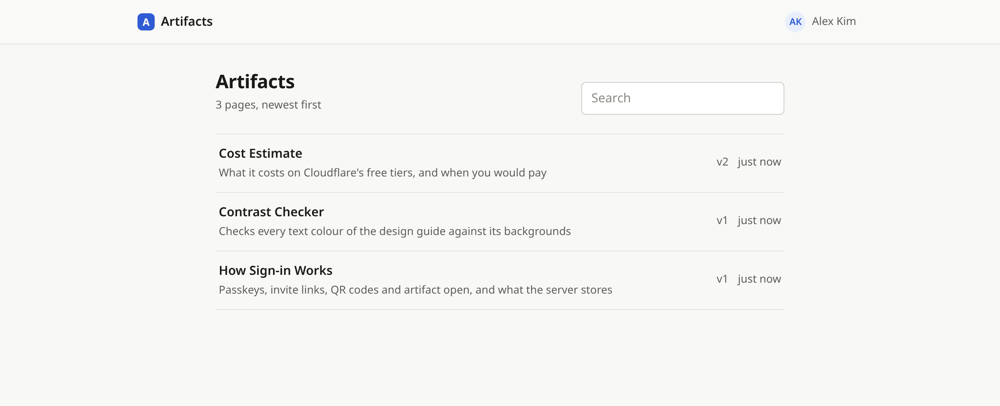
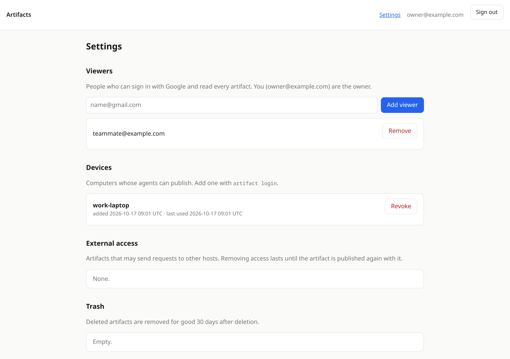

# SelfHostArtifacts

Private HTML pages for coding agents, on your own Cloudflare account. Codex CLI, Gemini CLI and
Claude Code publish a page with one MCP tool call and get back a URL that only you (and the
viewers you add) can open — like Claude's Artifacts, but self-hosted and for any agent.



```
Agent ──stdio MCP──▶ artifact (CLI on your computer) ──signed HTTPS──▶ Worker ── D1 + R2
                                                                        │
                       Browser ◀── passkey sign-in, sandboxed viewer ───┘
```

- **One hostname**, e.g. `artifacts.example.com`: `/` lists pages, `/a/<id>` shows one,
  `/settings` manages viewers and devices.
- **People** sign in with a passkey (fingerprint, face or screen lock). No OAuth app, no
  passwords. The owner invites viewers with single-use links; Google sign-in is optional.
- **Agents** never hold a password: each computer gets its own Ed25519 key, approved once in the
  browser (`artifact login`), and signs every request.
- **Pages are isolated**: they run in a CSP sandbox with an opaque origin, so a page's scripts
  cannot read your session, call the API as you, or reach other hosts unless you allow it.
- **Costs**: within Cloudflare's free tiers for personal use (estimate in [docs/design.md](docs/design.md)).

## What it looks like

You ask an agent for a page; it writes the HTML following the bundled design skill and publishes it.
Roughly, in Claude Code:

```text
> Make a page comparing our Cloudflare costs for personal and heavier use.

● selfhost-artifact-design (skill)
● Write examples/cost-estimate/index.html
● artifact.publish({ file_path: ".../cost-estimate/index.html" })
  ⎿ Published: https://artifacts.example.com/a/kfrxazsjwefc1xnf (version 1, private)

The page is at https://artifacts.example.com/a/kfrxazsjwefc1xnf
```

Ask for a change and it republishes to the same URL as version 2; older versions stay under
**Versions**.

<table>
<tr>
<td width="32%"></td>
<td></td>
</tr>
<tr>
<td align="center">Phone, dark mode</td>
<td align="center">Interactive pages work too (scripts run in the sandbox)</td>
</tr>
</table>

| Your pages | Settings |
|---|---|
|  |  |

Both sample pages are in [`examples/`](examples); publish one yourself with
`artifact publish examples/cost-estimate`.

## Deploy

You need a Cloudflare account with a zone (domain) for the hostname, Node 20+ and pnpm.

```bash
git clone https://github.com/Keyhole-Koro/SelfHostArtifacts.git
cd SelfHostArtifacts && pnpm install
cd packages/worker
npx wrangler login
pnpm run deploy
```

The script asks for the hostname, creates the D1 database and the R2 bucket, applies migrations,
deploys and generates the secrets. Nothing outside Cloudflare is needed. At the end it prints a
**one-time owner link**: open it and create a passkey, and you own the deployment.

```
Open this link to create the owner's passkey (works once, for 1 day):

  https://artifacts.example.com/invite/…
```

Then, in **Settings → People → Create invite link**, invite viewers. Each link works once; the
person opening it creates their own passkey. Add a passkey for each of your devices under
**Account** (passkeys synced by iCloud Keychain or Google Password Manager follow you anyway).

Lost every passkey? On a computer set up with `artifact`, run `artifact open`: it signs the
browser in with that computer's key. Or run `pnpm run deploy --owner-link` for a new owner link.

Run `pnpm run deploy` again to update. It reuses `wrangler.local.toml` (git-ignored) and only sets
secrets that are missing. All Cloudflare resources are declared in `wrangler.toml`.

<details>
<summary>Optional: Google sign-in as well</summary>

Answer "y" when the script asks about Google. It then asks for the owner's Google account
(`ROOT_EMAIL`) and an OAuth client: Google Cloud console → APIs & Services → Credentials →
Create credentials → OAuth client ID → Web application, with the redirect URI
`https://<your host>/auth/callback`. People added in Settings by Google account can then sign in
with Google too.
</details>

### Deploy from GitHub Actions

After the first deploy, pushing the `publish` branch releases from GitHub Actions:
`deploy-worker.yml` deploys the Worker (tests first, then migrations, deploy and a health check),
and `publish-cli.yml` publishes the CLI to npm when `packages/cli/package.json` has a version that
is not on npm yet. `main` only runs the tests. To release, push `main` into `publish`:

```bash
git push origin main:publish
```

In your fork, add under Settings → Secrets and variables → Actions:

| Kind | Name | Value |
|---|---|---|
| Secret | `CLOUDFLARE_API_TOKEN` | API token from the "Edit Cloudflare Workers" template, plus **D1: Edit** |
| Secret | `CLOUDFLARE_ACCOUNT_ID` | Your account id (`npx wrangler whoami`) |
| Secret | `ROOT_EMAIL` | Only with Google sign-in: the owner's Google account (a secret so it is masked in public logs) |
| Variable | `APP_HOST` | Your hostname |
| Variable | `D1_DATABASE_ID` | `database_id` from `wrangler.local.toml` |

Without `APP_HOST` the deploy job is skipped, so forks do not try to deploy. The CLI is published
with npm trusted publishing, so no npm token is stored; register `publish-cli.yml` as the
package's trusted publisher on npmjs.com.

## Use it from your agents

On each computer:

```bash
npm i -g @keyhole-koro/artifacts
artifact setup --host artifacts.example.com
```

`setup` pairs the computer (approve it in the browser as the owner), registers the MCP server with
every agent it finds (`codex mcp add`, `gemini mcp add --scope user`, `claude mcp add --scope user`)
and installs two skills, `selfhost-artifact-design` (how to write a good page) and `selfhost-artifact-publish` (when
and how to publish), into `~/.agents/skills` and `~/.claude/skills`. Restart the agents afterwards.

Then ask an agent for a page — "turn this CSV into a dashboard page" — and it writes the HTML,
calls `publish` and gives you the link. Ask for a change and it republishes to the same URL.

### MCP tools

| Tool | What it does |
|---|---|
| `publish` | Publish a local `.html` file, or a folder with `index.html`; the same file again updates the same URL |
| `read` | Read a published page or one of its files |
| `list` | Recent pages |
| `delete` | Move a page to the trash (restorable in Settings for 30 days) |

### CLI

```bash
artifact publish ./report.html            # or a folder; prints the URL
artifact publish ./site --allow-connect api.example.com
artifact list
artifact read https://artifacts.example.com/a/<id> data.json
artifact delete https://artifacts.example.com/a/<id>
artifact status
artifact open [url]                       # sign the browser in with this computer's key
artifact uninstall                        # remove the MCP registrations and skills
```

`--profile <name>` keeps a separate deployment or key; `--json` gives machine-readable output;
`--browser chrome` (or `ARTIFACT_BROWSER=chrome`) picks the browser for `login` and `open`, Flatpak
browsers included; `ARTIFACT_BROWSER=none` only prints the link.

## Development

```bash
pnpm install
pnpm test          # Worker tests run in workerd with D1 and R2
pnpm typecheck

cd packages/worker
cp .dev.vars.example .dev.vars
npx wrangler d1 migrations apply artifacts --local
pnpm dev           # http://localhost:8787, signs you in as DEV_LOGIN_EMAIL

cd ../cli
node src/cli.ts login --host localhost:8787
```

`DEV_LOGIN_EMAIL` skips sign-in (you become the owner) and is refused unless `APP_HOST` is localhost.

The design (in Japanese) is in [docs/design.md](docs/design.md).

## License

MIT
